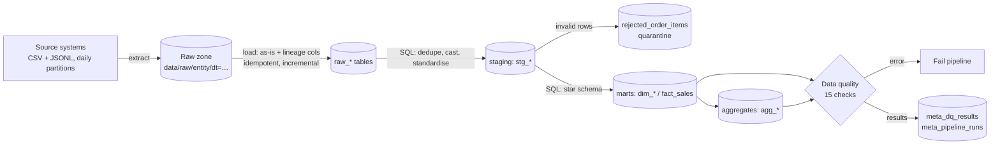
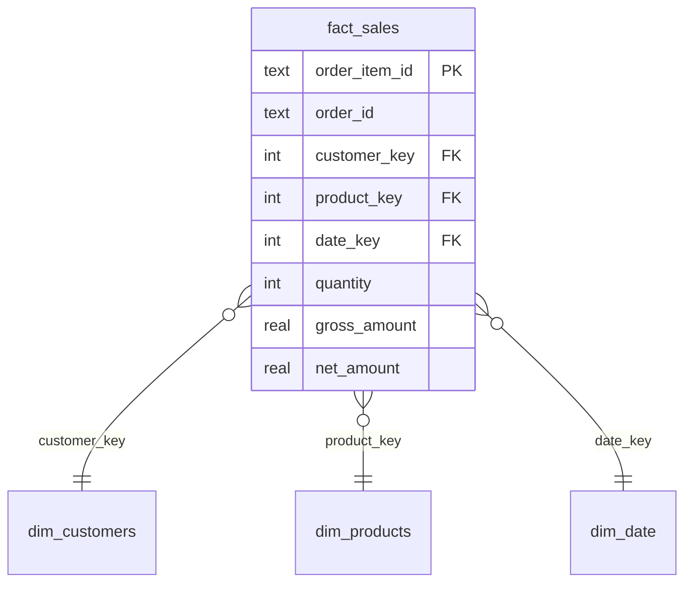

# E-commerce ELT Data Pipeline

An end-to-end **ELT** pipeline that ingests raw, messy source files, lands them in a warehouse,
models them into a **star schema** with SQL, and **validates** the result with automated
data-quality checks — fully tested, containerised, and CI-ready.

> **Stack:** Python 3.10+ · SQL (window functions, CTEs, recursive CTEs) · SQLite (swappable) ·
> pytest · GitHub Actions · Docker · Airflow DAG (optional)

## Architecture



### Data model (star schema)



Grain of `fact_sales`: **one row per order line item**. Aggregates built on top:
`agg_daily_sales` (with 7-day rolling average) and `agg_customer_value` (LTV + RFM-style segments).

## Why ELT, and the key design decisions

| Decision | Rationale |
|---|---|
| **ELT, not ETL** | Raw data is loaded untouched (all `TEXT`) with `_source_file` / `_loaded_at` lineage, so every transformation is reproducible and auditable in SQL. |
| **Idempotent, incremental loads** | `meta_load_log` tracks loaded files. Re-running never double-loads; new partitions are picked up automatically. |
| **Quarantine, don't drop** | Invalid line items (negative qty, unknown product) go to `rejected_order_items` with a reason. |
| **Declarative data-quality checks** | Each check is a SQL query returning violation count. `error` severity fails the run, `warn` is recorded. History persisted in `meta_dq_results`. |
| **Layered SQL models** | `raw → staging → marts`, one file per model in `sql/`, executed in dependency order. |
| **Observability** | Every stage writes status + duration to `meta_pipeline_runs`. |
| **Swappable warehouse** | All DB access sits behind `warehouse.py`; SQL is standard apart from a few date functions. |

## Dirty data the pipeline handles

The synthetic source generator injects real-world problems on purpose:
duplicate/late-arriving rows · malformed & missing emails · mixed-case emails ·
country names in 4 spellings (`United States`, `USA`, `us`, `US `) · mixed-case order status ·
negative quantities · order lines pointing at non-existent products.

## Quick start

```bash
git clone <Kofo-pix> && cd ecommerce-elt-pipeline
make run            # extract -> load -> transform -> quality  (no installs needed)
make analysis       # run business-question queries (needs the sqlite3 CLI)

pip install -r requirements-dev.txt
make test
```

Run a single stage: `PYTHONPATH=src python -m pipeline.run load` (also `extract|transform|quality`).

**Try the incremental load:** run `python -m pipeline.run all --days 30`, then
`--days 35` — only the 5 new daily partitions are loaded.

**Docker:** `make docker`

## Project structure

```
├── src/pipeline/
│   ├── extract.py      # synthetic source generator (partitioned raw zone)
│   ├── load.py         # idempotent raw loader with lineage
│   ├── transform.py    # runs SQL models in order
│   ├── quality.py      # data-quality framework
│   ├── warehouse.py    # DB adapter
│   └── run.py          # CLI + run logging
├── sql/
│   ├── staging/        # cleaning & typing
│   ├── marts/          # dims, fact, aggregates
│   └── analysis/       # business questions
├── dags/               # Airflow DAG
├── tests/              # pytest: determinism, idempotency, cleaning, DQ, reconciliation
└── .github/workflows/  # CI: lint + tests + smoke run
```

## Sample business questions (`sql/analysis/business_questions.sql`)

- Monthly revenue by product category
- Top customers by lifetime value and their segment (`VIP active`, `VIP at risk`, `Active`, `Dormant`)
- Weekend vs weekday sales
- Return rate by category
- What data was quarantined, and why

## Testing

`pytest` covers: deterministic extraction, idempotent + incremental loading, dedupe/standardisation
logic, quarantine behaviour, DQ checks passing on clean data **and failing on corrupted data**,
and revenue reconciliation between staging and the fact table.

## Roadmap / how I'd scale this

- Swap SQLite for **DuckDB / Postgres / BigQuery** by changing `warehouse.py`
- Move transformations to **dbt** (models already map 1:1 to `sql/`)
- Land raw files in **S3/GCS** as Parquet; add schema-drift detection
- Replace full-refresh marts with **incremental `MERGE`** models
- Add SCD Type 2 for customers, and a BI dashboard (Metabase / Superset) on the marts
